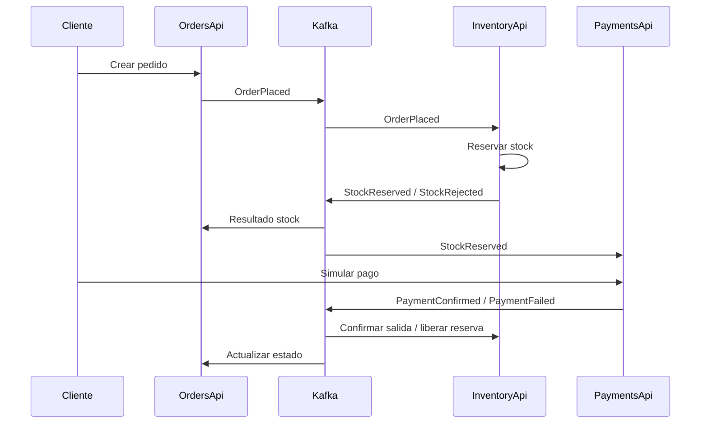

# Arquitectura

## Objetivo
Aplicar reutilización de software mediante microservicios independientes en C#, comunicación asíncrona con Kafka y despliegue en Docker, como exige el Tema 6.

## Componentes
1. Frontend estático (HTML/CSS/JS) servido por Nginx: catálogo, detalle, carrito, checkout y panel administrativo.
2. InventoryApi: catálogo, stock, reserva de unidades y movimientos.
3. OrdersApi: creación de pedidos, estado de pedidos, consulta del catálogo vía HTTP para tomar precios desde el servidor.
4. PaymentsApi: simulación de aprobación/rechazo de cobros; **no conecta con un banco**.
5. Shared: contratos de eventos y utilidades reutilizables de Kafka.
6. Kafka: tópico `shop-events`, consumidores en grupos distintos.

## Secuencia principal

## Estados
- `pending-stock`: espera confirmación de reserva.
- `awaiting-payment`: stock reservado; cobro pendiente.
- `rejected`: stock insuficiente.
- `paid`: pago aprobado en simulación.
- `payment-failed`: pago rechazado en simulación.
- `cancelled`: pedido cancelado antes del pago.

## Datos
Inventario: `Product`, `Reservation`, `StockMovement`, `ProcessedInventoryEvent`.
Pedidos: `ShopOrder`, `OrderItem`, `ProcessedOrderEvent`.
Cobros: `Payment`, `ProcessedPaymentEvent`.

Cada servicio es propietario de un esquema en el Postgres de Supabase: `inventory`, `orders` y `payments`. Comparten el proyecto, no las tablas. Los eventos incluyen un identificador UUID y los consumidores registran los eventos procesados para evitar volver a aplicar cambios tras recibir el mismo evento.

## Patrones y reutilización
- Microservicios con responsabilidades separadas.
- Publicación/suscripción mediante Kafka (estilo Observer basado en eventos).
- DTO y helper de mensajería reutilizables en `Shared`.
- Inyección de dependencias y servicios hospedados ASP.NET Core.
- No se fuerza Singleton/MVC: el Tema 6 exige Kafka, Docker y microservicios; MVC, Singleton y Observer se citan en el objetivo general, no como obligación explícita de implementar los tres en este tema.

## Consideraciones
La interfaz consulta estados por polling cada 2,5 s; la comunicación entre servicios es asíncrona por Kafka. El frontend no recibe directamente eventos Kafka. La creación de pedido consulta productos por HTTP para validar el precio del servidor; la reserva efectiva se hace en el consumidor de inventario.
