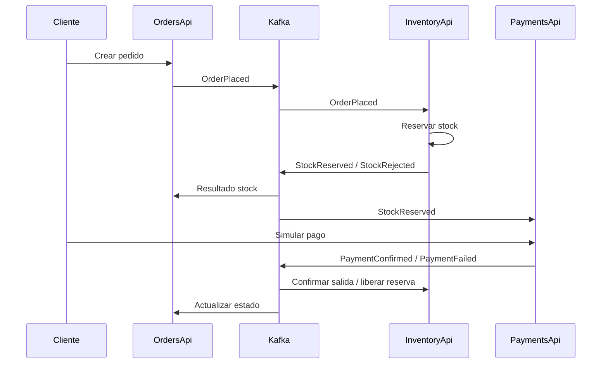

# Arquitectura

## Objetivo
Aplicar reutilización de software mediante microservicios independientes en C#, comunicación asíncrona con Kafka y despliegue en Docker, como exige el Tema 6.

## Componentes
1. Frontend estático (HTML/CSS/JS) servido por Nginx: catálogo, detalle, carrito, checkout, inicio de sesión, «Mis pedidos» y panel administrativo (solo admin).
2. InventoryApi: catálogo, stock, reserva de unidades y movimientos.
3. OrdersApi: creación de pedidos, estado de pedidos, consulta del catálogo vía HTTP para tomar precios desde el servidor.
4. PaymentsApi: simulación de aprobación/rechazo de cobros; **no conecta con un banco**.
5. Shared: contratos de eventos, utilidades reutilizables de Kafka y autenticación JWT compartida (`Security.cs`).
6. Kafka: tópico `shop-events`, consumidores en grupos distintos.
7. AuthApi: registro, inicio de sesión, roles (`admin`, `cliente`) y emisión de tokens JWT.

## Secuencia principal

## Estados
- `pending-stock`: espera confirmación de reserva.
- `awaiting-payment`: stock reservado; cobro pendiente.
- `rejected`: stock insuficiente.
- `paid`: pago aprobado en simulación.
- `payment-failed`: pago rechazado en simulación.
- `cancelled`: pedido cancelado antes del pago.

## Datos
Inventario: `Product`, `Reservation`, `StockMovement`, `ProcessedInventoryEvent`.
Pedidos: `ShopOrder`, `OrderItem`, `ProcessedOrderEvent`.
Cobros: `Payment`, `ProcessedPaymentEvent`.
Usuarios: `AppUser` (contraseña con PBKDF2-SHA256). El pedido guarda `UserId`, `Email` y `PaymentDetail` (solo marca y últimos 4 dígitos de la tarjeta).

Cada servicio es propietario de un esquema en el Postgres de Supabase: `identity`, `inventory`, `orders` y `payments`. Comparten el proyecto, no las tablas. Los eventos incluyen un identificador UUID y los consumidores registran los eventos procesados para evitar volver a aplicar cambios tras recibir el mismo evento.

## Patrones y reutilización
- Microservicios con responsabilidades separadas.
- Publicación/suscripción mediante Kafka (estilo Observer basado en eventos).
- DTO y helper de mensajería reutilizables en `Shared`.
- Autenticación reutilizable: `ShopAuth.AddShopAuth()` se llama igual en las cuatro APIs; las políticas `cliente` y `admin` se aplican con `RequireAuthorization`. Un solo componente define cómo se firma y valida el token.
- Inyección de dependencias y servicios hospedados ASP.NET Core.
- No se fuerza Singleton/MVC: el Tema 6 exige Kafka, Docker y microservicios; MVC, Singleton y Observer se citan en el objetivo general, no como obligación explícita de implementar los tres en este tema.

## Consideraciones
La interfaz consulta estados por polling cada 2,5 s; la comunicación entre servicios es asíncrona por Kafka. El frontend no recibe directamente eventos Kafka. La creación de pedido consulta productos por HTTP para validar el precio del servidor; la reserva efectiva se hace en el consumidor de inventario.

## Seguridad y permisos
`AuthApi` firma el token; inventario, pedidos y pagos lo validan localmente con la clave compartida `JWT_KEY`, así que no dependen de `AuthApi` en cada petición (si `AuthApi` se cae, las sesiones abiertas siguen funcionando hasta que vence el token).

- Público: catálogo, registro e inicio de sesión.
- Cliente: crear pedidos, ver y cancelar los suyos, simular el pago de los suyos.
- Admin: todo lo anterior más inventario, todos los pedidos, pagos y gestión de roles.

`PaymentsApi` reenvía el token del cliente al consultar el pedido en `OrdersApi`; así, la regla «solo el dueño o un admin» vive en un único lugar (`OrdersApi`). Los pedidos creados antes del login no tienen dueño y solo los ve el administrador.

Las validaciones del checkout (nombre, teléfono, dirección, método de pago y tarjeta con Luhn/vencimiento/CVV) se aplican en el navegador para dar respuesta inmediata y se repiten en `OrdersApi` (`OrderRules`), que es quien decide.
