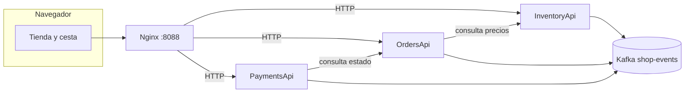

# Enfoque, decisiones, reutilización e interacción

La versión extendida para entregar está en [ENFOQUE.pdf](ENFOQUE.pdf).

Documento del Tema 6: tienda de relojes con microservicios, Apache Kafka y Docker. Describe el enfoque usado sobre el proyecto base `TiendaRelojes`, las decisiones de diseño, qué código se reutilizó y cómo se comunican las partes durante una compra.

## 1. Enfoque

El sistema modela una compra como una secuencia de hechos, no como una sola transacción dentro de un programa. Cada hecho viaja por Kafka en el tópico `shop-events`. El servicio que lo necesita reacciona y, si corresponde, publica otro hecho.

Se partió del proyecto base `TiendaRelojes`, que ya separaba catálogo, pedidos y cobros. El trabajo del tema consistió en completar esa separación: contratos comunes, reserva real de existencias, cobro simulado y una tienda desde la cual se recorre el flujo completo.

Hay dos formas de comunicación, y cada una tiene un motivo:

- **Kafka** lleva los cambios de negocio: pedido creado, stock reservado o rechazado, pago confirmado o fallido, pedido cancelado. Quien publica no llama al siguiente servicio. Quien escucha decide si el mensaje le corresponde.
- **HTTP** se usa solo cuando hace falta una respuesta inmediata. Pedidos consulta el catálogo para tomar el precio del servidor. Pagos consulta el estado del pedido antes de simular el cobro. El navegador consulta productos, pedidos y pagos a través de Nginx.

El navegador no se conecta a Kafka. La página pregunta el estado del pedido cada 2,5 segundos mientras la ventana de seguimiento está abierta. Así la interfaz muestra el avance sin convertirse en otro consumidor del bus.

Cada servicio es dueño de su base SQLite. Inventario no lee la tabla de pedidos, y pedidos no modifica el stock. El único dato que cruzan es el mensaje del evento.

## 2. Decisiones

| Decisión | Motivo |
|---|---|
| Conservar los tres servicios del proyecto base | El tema pide microservicios. Inventario, pedidos y pagos ya marcaban esas responsabilidades. |
| Un solo tópico, `shop-events`, con un campo `Type` | Un broker de demostración se explica mejor con un canal. Cada consumidor ignora los tipos que no le tocan. |
| Tres grupos de consumidores: `inventory-service`, `orders-service`, `payments-service` | En Kafka, cada grupo recibe una copia del mensaje. Así los tres servicios ven el mismo pedido. |
| Confirmación manual del offset (`EnableAutoCommit = false`) | El offset se confirma después de guardar en SQLite. Si el proceso se cae antes, el mensaje se vuelve a leer. |
| Tabla de eventos ya procesados en cada base | El mismo mensaje puede llegar dos veces. El `Id` del evento se guarda con índice único y la segunda vez no se vuelve a aplicar. |
| Crear el tópico al arrancar | Un broker nuevo no tiene `shop-events`. Los consumidores fallaban al suscribirse. `Events.EnsureTopic` lo crea con 1 partición y factor de réplica 1. |
| Reserva antes del cobro | `OrderPlaced` no descuenta el stock. Lo aparta en `Reserved`. La salida real ocurre solo con `PaymentConfirmed`. Si el pago falla o el pedido se cancela, la reserva vuelve al disponible. |
| El precio lo fija inventario | El navegador envía identificador y cantidad. Pedidos pide `GET /products` y copia el precio de ese momento. El cliente no puede inventar el monto. |
| Cobro simulado | El alcance es académico. `POST /payments/{id}/simulate` acepta `approved` o `rejected`. No hay pasarela ni cargo real. |
| SQLite por servicio, en un volumen Docker | Cada uno arranca con `EnsureCreated` y conserva sus datos al reiniciar el contenedor. No hay una base compartida que acople los servicios. |
| Productor con `Acks.All` e idempotencia | El mensaje se considera publicado cuando el broker lo acepta. Se reduce el riesgo de duplicarlo por un reintento del productor. |
| Cesta visible junto al catálogo | El alta del pedido no depende de un cuadro oculto. Cada reloj tiene «Añadir a la cesta» y el formulario queda en la misma página. |
| Nginx como única puerta | El navegador habla con el puerto 8088. `/api/inventory/`, `/api/orders/` y `/api/payments/` se reenvían al servicio correspondiente. El resto son los archivos estáticos. |
| Kafka de un solo nodo en Compose | Basta para la demostración. El factor de réplica es 1. No representa un clúster de producción. |

Lo que quedó fuera a propósito: caja de salida transaccional, caducidad de reservas, autenticación y conciliación si SQLite se guarda y Kafka no alcanza a recibir el mensaje. Esas piezas cambian el prototipo a un sistema de producción y no forman parte de esta entrega. El README las deja escritas como limitación.

## 3. Reutilización del código

El proyecto base aportó la tienda, los tres proyectos ASP.NET Core, Nginx, Docker Compose y el catálogo inicial de cuatro relojes. No se reemplazó ese esqueleto: se completó la mensajería y la pantalla de compra.

### Lo que comparten los tres servicios

`Shared/Messaging.cs` es el único código de integración. Los tres proyectos referencian esa biblioteca y llaman a los mismos miembros:

- Los contratos `OrderPlaced`, `StockReserved`, `StockRejected`, `PaymentConfirmed`, `PaymentFailed` y `OrderCancelled`.
- El sobre `EventMessage`, con `Id`, `Type`, `Data` y `CreatedAt`.
- `Events.Json` y `Events.Parse` para serializar ese sobre.
- `Events.Publish` para enviar.
- `Events.Consumer` para suscribirse a `shop-events` con el grupo que corresponda.
- `Events.EnsureTopic` para preparar el tópico antes de publicar o de escuchar.

Ningún servicio construye su propio productor. Si cambia el nombre del tópico o la forma del sobre, el cambio se hace en un solo archivo.

### Lo que se repite como patrón, con reglas distintas

Los tres programas siguen la misma forma: API mínima, Entity Framework Core, SQLite, `EnsureCreated`, CORS, `GET /health` y un `BackgroundService` que consume Kafka. Esa forma se reutiliza, pero la regla de negocio no se metió en `Shared`:

- `InventoryWorker` reserva, rechaza, confirma la venta o libera.
- `OrderWorker` cambia el estado del pedido.
- `PaymentsWorker` abre el pago pendiente cuando llega `StockReserved`.

Cada base tiene su tabla de eventos procesados (`ProcessedInventoryEvent`, `ProcessedOrderEvent`, `ProcessedPaymentEvent`) con el mismo índice único sobre `EventId`. El registro vive en la base del servicio porque la idempotencia es local: que inventario ya haya aplicado un mensaje no significa que pedidos también lo haya hecho.

### Lo que no se comparte

`Product`, `ShopOrder` y `Payment` no están en `Shared`. Compartir esas tablas obligaría a una base común y rompería el límite entre servicios. El navegador tampoco reutiliza la biblioteca de Kafka: solo conoce las rutas HTTP.

La cesta, el catálogo y el panel de administración ya existían en `frontend/`. Se reutilizó esa página y se dejó la cesta visible, con el alta del pedido en el mismo formulario.

## 4. Cómo interactúa cada parte

### Arranque

`docker compose up --build` levanta Kafka, las tres APIs y Nginx. Las APIs esperan a que Kafka responda. Al iniciar, cada una crea su archivo SQLite. Inventario carga los cuatro relojes si la tabla está vacía. Los tres trabajadores esperan tres segundos y se suscriben a `shop-events`. Nginx publica la tienda en el puerto 8088.

### Consulta del catálogo

1. El navegador pide `GET /api/inventory/products`.
2. Nginx lo entrega a InventoryApi como `GET /products`.
3. La página muestra nombre, precio y unidades disponibles (`Stock - Reserved`).
4. «Añadir a la cesta» solo guarda la selección en el navegador. Todavía no hay pedido ni evento.

### Creación del pedido

1. La cesta envía `POST /api/orders/orders` con cliente, teléfono, dirección, forma de pago, identificadores y cantidades.
2. OrdersApi rechaza datos vacíos, más de 30 líneas o cantidades fuera de 1 a 100.
3. OrdersApi llama por HTTP a InventoryApi `GET /products`, agrupa líneas repetidas y copia nombre y precio.
4. Guarda el pedido en `orders.db` con estado `pending-stock` y responde `202 Accepted`.
5. Publica `OrderPlaced` con el identificador del pedido y las líneas.

Si Kafka no acepta el mensaje, el pedido queda guardado y la API responde 503. Esa es la limitación descrita arriba: no hay reintento automático.

### Reserva de inventario

1. `InventoryWorker`, grupo `inventory-service`, lee `OrderPlaced`.
2. Si el evento ya está en `ProcessedInventoryEvent`, confirma el offset y no hace nada más.
3. Comprueba que cada línea tenga disponible `Stock - Reserved`.
4. Si alcanza, suma `Reserved`, crea filas en `Reservation` y publica `StockReserved`.
5. Si no alcanza, no aparta nada y publica `StockRejected`.
6. Guarda el identificador del evento y confirma el offset.

`OrderWorker` recibe ese resultado:

- `StockReserved` con el pedido en `pending-stock` lo pasa a `awaiting-payment`.
- `StockRejected` lo pasa a `rejected`.

`PaymentsWorker` recibe el mismo `StockReserved` y, si ese pedido aún no tiene pago, inserta uno en estado `pending`.

### Seguimiento en la página

La ventana de seguimiento llama `GET /api/orders/orders/{id}` al abrirse y otra vez cada 2,5 segundos. Los botones de pago se habilitan solo cuando el estado es `awaiting-payment`.

### Simulación del pago

1. El navegador envía `POST /api/payments/payments/{id}/simulate` con `approved` o `rejected`.
2. PaymentsApi consulta `GET /orders/{id}` en OrdersApi.
3. Solo continúa si el pedido está en `awaiting-payment` y el pago sigue `pending`.
4. Guarda el monto y el resultado.
5. Publica `PaymentConfirmed` o `PaymentFailed`.

A partir de ahí cada servicio actúa sobre su propia base:

- OrdersApi pasa el pedido a `paid` o a `payment-failed`.
- InventoryApi busca las reservas en estado `reserved`. En un pago confirmado resta `Stock`, baja `Reserved`, marca la reserva `sold` y escribe un movimiento negativo. En un pago fallido solo baja `Reserved` y marca la reserva `released`. El stock disponible vuelve a subir sin haber salido de bodega.

Cuando la página ve `paid`, `rejected` o `payment-failed`, vuelve a cargar el catálogo para mostrar las existencias nuevas.

### Cancelación

`POST /api/orders/orders/{id}/cancel` solo acepta `pending-stock` o `awaiting-payment`. OrdersApi marca `cancelled` y publica `OrderCancelled`. InventoryApi libera las reservas igual que en un pago fallido. `OrderWorker` ignora mensajes posteriores de un pedido ya cancelado.

### Administración

El panel usa solo InventoryApi y OrdersApi por HTTP: listar movimientos, ajustar existencias con `POST /products/{id}/adjust` y registrar un reloj con `POST /products`. Esos cambios no pasan por Kafka porque no forman parte del flujo de un pedido.

## 5. Lectura rápida de una venta

| Paso | Quién habla | Canal | Qué queda guardado |
|---|---|---|---|
| Ver relojes | Navegador e inventario | HTTP | Nada nuevo |
| Crear pedido | Navegador y pedidos; pedidos e inventario | HTTP | Pedido `pending-stock` |
| Avisar la compra | Pedidos | Kafka `OrderPlaced` | Mensaje en `shop-events` |
| Apartar unidades | Inventario | Kafka `StockReserved` o `StockRejected` | Reserva o rechazo |
| Actualizar el pedido | Pedidos | Lee Kafka | `awaiting-payment` o `rejected` |
| Abrir el cobro | Pagos | Lee Kafka | Pago `pending` |
| Simular el pago | Navegador, pagos y pedidos | HTTP y luego Kafka | Pago `approved` o `rejected` |
| Cerrar la venta | Inventario y pedidos | Leen Kafka | Stock descontado o reserva liberada; pedido `paid` o `payment-failed` |
